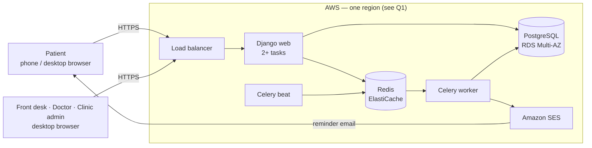
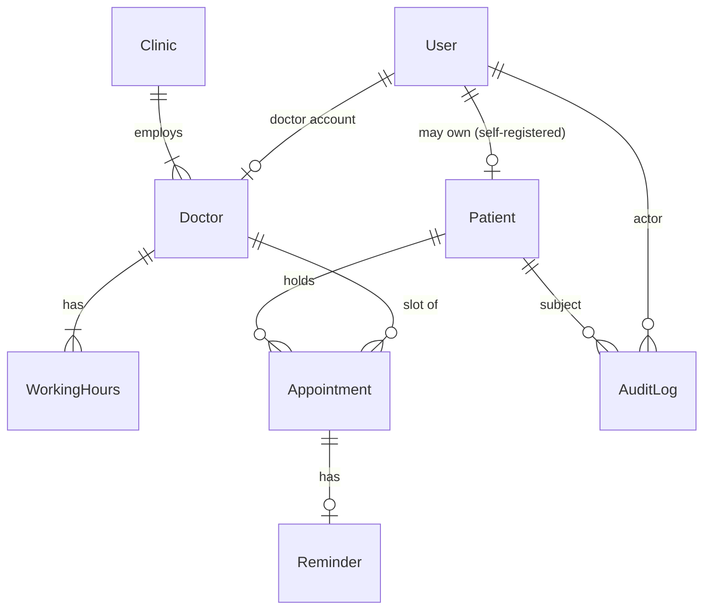

# ARCH-CARESLOT-v1 — CareSlot architecture

## 1. Document Metadata

| Field | Value |
|---|---|
| Version | 1.0 |
| Date | 2026-11-23 |
| Status | Proposed |
| Owners | Tech lead (one of the two developers); architect |
| Source documents | `docs/requirements/BRD.md` v1.0 (BR-001 – BR-018); `docs/requirements/PRD.md` v1.0 (US-001 – US-014, FR-*, NFR-*); `docs/requirements/sources/team-constraints.md` |
| Epics | E001 – E006, one ADR file each in this folder |

## 2. System Overview

CareSlot is a single web application with two audiences:

- **Patients** (phone and desktop browsers) register, book, see and cancel their appointments (US-001 – US-005).
  They also receive an email reminder (US-006).
- **Clinic staff** (desktop) — front desk, doctors and clinic admin — run the schedule (US-007 – US-013).

There is one server-rendered web client for both audiences. There is no mobile app and no public API. Up to about 200
patients are online at the busiest time (team-constraints).

## 3. Component Breakdown

The system is one Django project, a modular monolith (team pattern). Each Django app below owns its models and
services, and other apps call its service functions, never its tables directly.

| Component | Responsibility | Talks to | Epic | Covers |
|---|---|---|---|---|
| `accounts` | Patient registration, sign-in, lockout, idle sign-out, roles, staff accounts | PostgreSQL, Redis (sessions), `audit` | E001 | US-001, US-002, US-012; FR-AUTH-001 – 005, FR-ADMIN-001 |
| `scheduling` | Clinics, doctors, weekly working hours, slot generation, the **booking service** (the one write path for book / move / cancel) | PostgreSQL, `audit`, `notifications` | E002 | US-013; FR-ADMIN-002, FR-BOOK-003 – 006 |
| `patient_portal` | Patient pages: browse clinic → doctor → date → slot, book, own list, cancel | `scheduling`, `accounts` | E003 | US-003 – US-005; FR-BOOK-001, FR-BOOK-002, FR-APPT-001, FR-APPT-002 |
| `staff_portal` | Front-desk day view, book / move / cancel for patients, patient records; doctor's day list | `scheduling`, `accounts` | E004 | US-007 – US-011; FR-DESK-001 – 004, FR-DOC-001 |
| `notifications` | Reminder outbox: create, reschedule and cancel reminders; send due reminders by email with retries | PostgreSQL, Celery/Redis, Amazon SES | E005 | US-006; FR-NOTIF-001 |
| `audit` | Append-only log of every view and change of patient data | PostgreSQL | E006 | US-014; FR-AUDIT-001 |
| Celery worker | Runs the reminder-sending task | Redis, PostgreSQL, SES | E005 | FR-NOTIF-001 |
| Celery beat | Triggers the reminder-sending task every minute | Redis | E005 | FR-NOTIF-001 |

## 4. Technology Choices

### Backend language and framework
- **Choice**: Python 3.13 + Django 6.1 (6.1.3 is the latest on PyPI, checked 2026-11-23). Upgrade to Django's next LTS release before go-live (2027-10-01).
- **Rationale**: Both developers are strong in Python/Django (team-constraints). Django's auth, sessions, forms, ORM
  and admin cover FR-AUTH-*, FR-ADMIN-* and most of the booking pages in ~10 weeks. Serves BR-016, NFR-SEC-003.
- **ADR**: ADR-CARESLOT-E001-001

### Web client (patients and staff)
- **Choice**: Server-rendered Django templates + htmx, mobile-first CSS built on `docs/designs/design-system/tokens.css`
- **Prior choice (superseded)**: Building on the designer's React export — not taken; the export is a visual reference only.
- **Rationale**: Nobody on the team has run a React SPA in production, and one of them has used htmx. One codebase
  keeps every rule server-side (FR-BOOK-005/006, FR-AUTH-005). Small HTML pages serve NFR-001 (≤ 2 s p95 on 4G),
  NFR-003 (browsers) and NFR-004 (WCAG 2.1 AA).
- **ADR**: ADR-CARESLOT-E003-001

### Database and booking integrity
- **Choice**: PostgreSQL on Amazon RDS, Multi-AZ; psycopg 3
- **Rationale**: Double bookings must be impossible (BR-004, FR-BOOK-005): a partial unique index on
  `(doctor_id, start)` for booked appointments rejects the second write on every channel. The 2-appointment limit
  (BR-003, FR-BOOK-006) is checked inside a transaction that locks the patient row. Multi-AZ serves NFR-002.
- **ADR**: ADR-CARESLOT-E002-001

### Background jobs
- **Choice**: Celery 5 with Redis (Amazon ElastiCache) as broker; reminder outbox table in PostgreSQL
- **Rationale**: Nobody is on call at night, and reminders must not be lost if the provider is down
  (team-constraints). The outbox makes the database the record of what is due, and a job sends every due, unsent
  reminder with retries. Serves FR-NOTIF-001, BR-008.
- **ADR**: ADR-CARESLOT-E005-001

### Email delivery
- **Choice**: Amazon SES, in the hosting region
- **Rationale**: Reminders are email only (PO, 2026-11-23; BR-008). The clinic's SMS provider is not used in
  release 1. SES runs in the clinic's AWS account.
- **ADR**: ADR-CARESLOT-E005-002

### Authentication and authorization
- **Choice**: Django authentication + django-axes (lockout); database-backed sessions with a 30-minute idle expiry; role checks in views and services
- **Rationale**: FR-AUTH-001 – 005, BR-016 – BR-018, NFR-SEC-002/003. Authorization is enforced server-side (team pattern).
- **ADR**: ADR-CARESLOT-E001-002

### Audit log
- **Choice**: Append-only `AuditLog` table in PostgreSQL, written by the service layer; 5-year retention
- **Rationale**: FR-AUDIT-001, BR-015, NFR-SEC-004.
- **ADR**: ADR-CARESLOT-E006-001

### Hosting and runtime
- **Choice**: AWS ECS on Fargate (web, worker and beat as separate services) behind an Application Load Balancer; gunicorn; AWS Secrets Manager; CloudWatch logs and alarms
- **Rationale**: ECS restarts crashed tasks on its own, with nobody on call (team-constraints). Two or more web tasks
  serve NFR-002. All resources are in one region for NFR-SEC-001, but which region is open (Q1).
- **ADR**: ADR-CARESLOT-E001-003

## 5. Data Model

| Entity | Key fields | Rules |
|---|---|---|
| User | email (unique), password hash, role (`patient`, `front_desk`, `doctor`, `clinic_admin`), is_active | FR-AUTH-001, FR-AUTH-005, FR-ADMIN-001 |
| Patient | name, email, phone, user (nullable) | Front desk can create a record without a user (FR-DESK-002); linking to a later self-registration is PRD OQ 3 |
| Clinic | name | 3 clinics |
| Doctor | name, clinic (exactly one), user | Each doctor works at one clinic (PO, 2026-11-23) |
| WorkingHours | doctor, weekday, start_time, end_time | Slots are generated from these, 20 minutes each, not stored (FR-BOOK-003) |
| Appointment | doctor, patient, start, status (`booked`, `cancelled`), reason (required), channel (`online`, `front_desk`), created_by | Partial unique index `(doctor_id, start) WHERE status='booked'` (FR-BOOK-005). `channel` feeds the online-share metric (BRD G2) |
| Reminder | appointment, due_at (18:00 clinic time on the day before), sent_at, attempts, last_error, status | FR-NOTIF-001 |
| AuditLog | actor (user), patient, action (`view`, `create`, `update`, `cancel`), object, at | Insert only (FR-AUDIT-001) |

## 6. Integration and API Design

- **No public API.** All pages are server-rendered. htmx requests go to the same Django views and return HTML
  fragments (slot lists, day grid). They are covered by the same session and role checks (FR-AUTH-005).
- **Booking service** (`scheduling.services`) is the only code that books, moves or cancels. The patient portal and
  the staff portal both call it, so these rules hold on every channel:
  - the slot is inside working hours and is 20 minutes long (FR-BOOK-003);
  - the reason for visit is not empty (FR-BOOK-004);
  - the slot is free, enforced by the database constraint (FR-BOOK-005);
  - the patient holds fewer than 2 future booked appointments, checked under a patient-row lock (FR-BOOK-006);
  - channel rules: online only within 30 days and before the start (FR-BOOK-002); online cancel only until 2 hours
    before the start (FR-APPT-002); staff cancel until the start (FR-DESK-004); moves are staff only (FR-DESK-003).
  - In the same transaction, it creates, moves or cancels the appointment's Reminder (FR-NOTIF-001) and writes an
    AuditLog entry (FR-AUDIT-001).
- **Amazon SES**: the worker sends email through the SES API with IAM role credentials. No secrets are kept in the
  repository (team pattern).

## 7. Deployment Topology

| Piece | AWS service | Size / count | Recovery |
|---|---|---|---|
| Web | ECS Fargate service, gunicorn | ≥ 2 tasks in 2 AZs | ECS replaces failed tasks; ALB health check |
| Worker | ECS Fargate service, Celery worker | 1 task | ECS restarts it; unsent reminders stay in the outbox |
| Beat | ECS Fargate service, Celery beat | exactly 1 task | ECS restarts it; a missed minute is caught up by the next run (due_at ≤ now) |
| Database | RDS PostgreSQL, Multi-AZ, automated backups | — | Automatic failover |
| Broker / cache | ElastiCache Redis | — | Holds no data we can't rebuild; the outbox lives in PostgreSQL |
| Email | Amazon SES | — | Retries from the outbox |
| Secrets | AWS Secrets Manager | — | — |
| Monitoring | CloudWatch logs + alarms (5xx rate, unsent reminders older than 1 hour, task restarts) | — | Alarms are read in working hours (nobody on call) |

Environments: staging and production, the same shape and the same region. **Region: open (Q1).**

## 8. NFR Fulfillment

| NFR | How it's met |
|---|---|
| NFR-001 | Server-rendered pages with minimal JS (htmx). Slot lists are queried by indexed `(doctor_id, start)`. Measured with a p95 load test on throttled 4G before launch (ADR-CARESLOT-E003-001). |
| NFR-002 | ≥ 2 web tasks in 2 AZs, RDS Multi-AZ, ECS self-healing (ADR-CARESLOT-E001-003). Measured from ALB/CloudWatch availability per month. |
| NFR-003 | Plain HTML/CSS + htmx. CI runs the main flows in Chrome, Safari (WebKit) and Edge (Chromium), desktop and mobile viewports. |
| NFR-004 | Semantic HTML forms, design-system tokens checked for contrast, axe checks in CI, a manual WCAG 2.1 AA pass before launch. |
| NFR-005 | Templates and emails in English. Django i18n is not enabled in release 1. |
| NFR-SEC-001 | **Not yet met.** All resources go in one AWS region, but no AWS region in the Philippines was found (web search, not conclusive). See Q1. |
| NFR-SEC-002 | django-axes: 5 failures per account, 15-minute cool-off (ADR-CARESLOT-E001-002). |
| NFR-SEC-003 | `SESSION_COOKIE_AGE = 1800` with `SESSION_SAVE_EVERY_REQUEST = True` (ADR-CARESLOT-E001-002). |
| NFR-SEC-004 | AuditLog rows are kept 5 years. Deletion is allowed only for rows older than 5 years, by a scheduled job. The app's DB role has no UPDATE/DELETE on the table (ADR-CARESLOT-E006-001). |

## 9. Open Questions and Deferred Decisions

| # | Question / decision | Owner | Blocks |
|---|---|---|---|
| Q1 | Which AWS region is "the clinic's region"? BR-013 requires storage in the Philippines, and no AWS region in the Philippines was found (web search 2026-11-23, not conclusive). If the region is outside the Philippines, BR-013 needs a change request approved by the DPO. | DPO + clinic IT | NFR-SEC-001, ADR-CARESLOT-E001-003, ADR-CARESLOT-E005-002 |
| Q2 | Clinic time zone for "18:00 the day before". Kept as one setting; value to confirm. | Clinic manager | FR-NOTIF-001 |
| Q3 | Reminder for bookings made after 18:00 the day before, or on the same day (PRD OQ 1). Design: Reminder.due_at is computed at booking; the rule only changes that computation. | Clinic manager | FR-NOTIF-001 |
| Q4 | Link a front-desk patient record to a later self-registration with the same email (PRD OQ 3). Design: `Patient.user` is nullable so either answer fits. | Front-desk lead | FR-BOOK-006 |
| Q5 | 30-day limit for staff bookings and moves (PRD OQ 4), and what happens to appointments when working hours shrink (PRD OQ 5). Both are booking-service rules. | Clinic manager | FR-DESK-002, FR-DESK-003, FR-ADMIN-002 |
| Q6 | Email the patient when staff move or cancel (PRD OQ 6). The outbox can carry other email types if yes. | Clinic manager | FR-DESK-003, FR-DESK-004 |
| Q7 | How the DPO reads the access log (PRD OQ 7). Deferred; the data is captured from day one. | DPO | FR-AUDIT-001 |
| D1 | The upgrade to Django's next LTS release before go-live. Its release date was not checked. | Tech lead | — |
